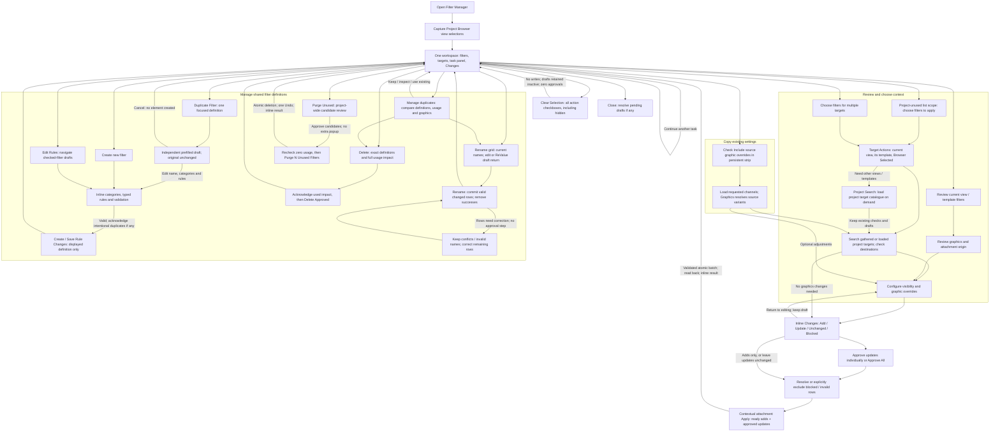
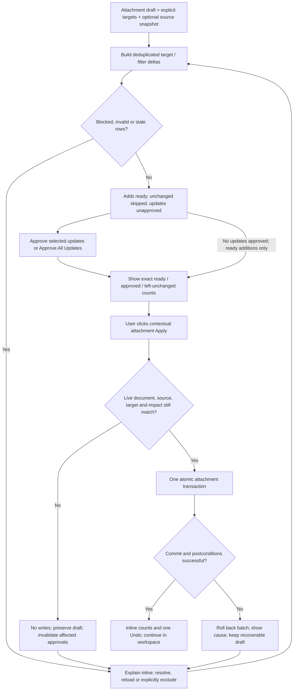

# Filter Manager - Full Workflow v3

**Design proposal, 2026-11-05. Not implemented.** [SCOPE.md](SCOPE.md) defines requirements; [help.md](help.md) still describes the current BETA. This document maps user movement, design references, safeguards and implementation acceptance. No runtime or model changes accompany this proposal.

## Design decision: one workspace, not a wizard

Keep the filter library, target selection and pending-change summary available while the centre switches between Graphics, Edit Rules, Rename and inline management tasks. Users can inspect, configure, create, duplicate and apply in one visit. There is no mandatory Next/Back sequence and no separate normal application-review or success window.

- **Source -> Task -> Targets:** the left source selector has Current View / Template, Browser View / Template, Selected Views / Templates, All Project Filters. **Graphics / Edit Rules / Rename** are tabs within the middle panel; source and target panes stay visible. Open in Graphics; definition/usage details remain available with the focused filter.
- **Copy is explicit, not a tab:** adjacent independent **Include source graphic overrides** and **Include source visibility**, both checked by default for valid attachment sources, with source/count summary. Preserve subsequent user choices; default-on is not project-wide preload. Load only checked-filter/requested-channel data on demand; All Project Filters disables both and has no implicit source settings. No source Options menu or enabled-state choice. From source / Custom / Mixed labels and exact-clear deltas make intent visible; unchecking one removes only that channel's source request, not the other channel or custom edits.
- **Enabled policy:** all new attachments are enabled, including when a source is disabled. Existing attachments keep their enabled state, including disabled ones; do not copy, edit or request approval for enabled-state changes. Source visibility Off remains an independent supported choice.
- **Edit Rules:** the same stable checked-filter navigator as Graphics, including hidden checks, disabled endpoints and shared focus. Independent rule/category drafts survive arrows/tabs; no Together rule replacement or automatic save. Save Rule Changes commits only the displayed draft and shows shared project-wide impact.
- **Rename:** a grid without arrows or approval checkboxes, current-name defaults, direct corrections and optional generation. Edit in ReValue returns find/replace, token rearrangement and prefix/suffix transformations as drafts, not writes. Rename commits the valid changed subset; successes/unchanged leave the grid and only unresolved rows remain for correction/retry, with exact counts.
- **Empty All Project graphics** means no requested overrides, not a graphics reset. Add missing attachments with native defaults; preserve existing target overrides. Multiple attachment sources show common / Mixed values and resolve differing copy variants per filter, never by arbitrary first source.
- **Graphics editing:** default Per Filter with Previous / i of N / Next; Together (N) explicitly patches edited fields across all checked filters/destinations. Mode changes and arrows preserve independent drafts and never write; untouched Mixed values remain unchanged.
- **Graphics-loading decision is benchmark-gated.** Do not preload every project attachment's graphics at launch without representative performance evidence and agreed budgets. Investigate per-filter/on-demand and bounded checked-set loading against eager preload before production implementation; unloaded graphics are never represented as empty/default or already-compared variants.
- **Inspecting** never writes.
- **Checking** selects the scope for a labelled action; highlighting only inspects.
- **Changing graphics** creates an attachment draft, never a live preview.
- **Add Filters / Apply Graphic Changes / Apply Filters + Graphics** reflects the actual active attachment proposal and commits ready additions and approved updates only; visibility-only requests use **Apply Filters + Visibility / Apply Visibility Changes** as appropriate. Show unapproved updates left unchanged. Tab navigation never disguises pending writes.
- **Apply first, review only existing updates:** ready new attachments require no approval or review-panel visit. Existing unchanged attachments are skipped; requested changes to existing attachments remain pending until approved. After Apply/readback, remove successful/unchanged work-list entries and retain only pending updates/unresolved rows, e.g. **8 added · 3 existing attachments await approval**. Completed additions must not be requeued as updates without a new requested change.
- **Optional detail only:** remove redundant Review graphics (use the Graphics tab). **Changes** expands before/after details and approvals when wanted; it is not a required step before applying ready additions. No separate review/confirmation/success screen.
- **Create Filter / Save Rule Changes / Rename / Delete Approved Definitions / Purge N Unused Filters** commit their own clearly labelled definition operations, independently of attachment Apply.
- **Duplicate Filter** opens a new-definition draft from one focused source. It creates nothing until Create Filter, never edits the original, and does not copy attachments/graphics. **Analyse Duplicates** remains the separate project-wide comparison task.
- **Purge Unused** replaces Select Unused as the management action: review definitions with no attachments anywhere, then delete the approved set with one counted commit. Project-unused remains a separate non-destructive browsing scope.
- **Clear Selection** clears every action-selection/approval checkbox, including hidden rows, in one click. Preserve configuration values and drafts; local Clear filters / Clear targets support clearing just one pane.
- **Target source dropdown** displays **View**, **Template**, **Browser** or **Project** as its current state. The first three use only their explicit candidates; Project loads the project catalogue on demand. **Clear** unticks every destination and returns to Project, loading it if necessary; **Reset search** clears only search restrictions, not selections/source.
- Navigation and Cancel return to the same context. Closing with pending work offers Apply / Discard / Stay; invalid or unapproved work cannot be silently applied. Already committed definition changes are not undone by discarding an attachment draft.

## User-task graph

All task panels below live inside the same main dialogue. The return paths mean continuing work in that dialogue, not closing/reopening it.

New/Edit/Duplicate Filter validation errors stay in the inline editor. Intentional identical-definition acknowledgements and used-delete acknowledgements are inline exception states, not additional compulsory screens. A duplicate-as-starting-point draft needs the identical-definition acknowledgement only if it still matches an existing definition when created. Definition and attachment commit failures roll back their own operation, retain recoverable drafts and show actionable errors.

## Attachment safety and approval graph

This expands the Changes path above. It is not a wizard: users can edit the proposal or targets from the same workspace at any point before writing.

Approve All Updates includes eligible updates hidden by the Changes search, with that count visible. It excludes invalid/blocked/stale rows and definition deletion. Unapproved updates are left unchanged and remain clearly identified; they do not prevent intentionally applying independent ready additions.

## Thirteen task paths and Clear Selection

Searches, field entry and individual row checks are omitted from the navigation counts. Counts describe the proposed controls, not measured usability results. Current-context tasks assume the intended writable target is already selected; choosing a controlling template adds one explicit click.

| # | User task | Shortest intended path | Navigation / commit target |
|---|---|---|---|
| 1 | Review filters in current view/template | Open -> Graphics, Current View / Template resolves effective origin -> focus filter | Ready at launch; one row-focus action to inspect a specific filter |
| 2 | Add unused filters to current view/template | All Project Filters -> Project-unused narrowing -> check definitions -> Graphics -> Apply | No deletion or extra review window; blank graphics are valid; source/menu opening adds its normal click |
| 3 | Add filters to multiple views/templates | Check filters + targets, or use imported browser targets -> Graphics -> optional field edits -> Apply | Two action clicks beyond selections when defaults suffice |
| 4 | Create new filters | + New -> fill inline draft -> Create Filter | Two action clicks beyond data entry; new filter focused/checked for subsequent application |
| 5 | Edit existing filters | Check filters -> Edit Rules -> arrows/focus -> Save Rule Changes | Save only the displayed definition; other drafts retained and shared impact visible |
| 6 | Rename filters | Check definitions -> Rename tab -> edit current-name grid or ReValue proposals -> Rename | No approval clicks; successes leave the grid; correct remaining rows and Rename again |
| 7 | Delete filters | Check definitions -> Delete -> inspect exact impact -> Delete Approved Definitions | Two action clicks; one additional acknowledgement only if approved definitions are used |
| 8 | Manage duplicates | Analyse Duplicates -> inspect a group -> Keep / Use Existing / Rename / Delete | One action to analysis; only the chosen follow-up adds its normal safeguards |
| 9 | Review attachment graphics | Focus a filter/target -> Graphics | At most one section change beyond focus; mixed and inherited values labelled |
| 10 | Apply attachment graphics | Graphics -> edit one/checked-set fields -> approve existing updates inline -> Apply | No extra review/confirmation modal; one Approve All action can approve the current update set |
| 11 | Copy graphics | Choose source set + filters + targets -> Include source graphic overrides -> Graphics channels/variants if needed -> approve updates -> Apply Filters + Graphics | No Copy tab; identical values need no conflict click; differing variants need explicit choice or bulk preferred source; one final commit |
| 12 | Duplicate a filter as a starting point | Focus source -> Duplicate Filter -> edit prefilled name/categories/rules -> Create Filter | Two action clicks beyond focus/data entry; no immediate creation or source changes |
| 13 | Purge unused filters | Purge Unused -> inspect/uncheck project-wide candidates -> Purge N Unused Filters | Two action clicks; one inline review, no second confirmation or used-filter acknowledgement |

**Clear Selection** is a one-click supporting action, available from every task panel. It clears filters/source attachments, destinations and review approvals across the workspace, including hidden rows. It does not reset graphics values, definition-category choices, copy channels, search, source choice or Revit selection. Retained graphics edits become inactive until reselected; approvals must be granted again.

**Unused** means no attachment anywhere in the active project, including disabled/hidden attachments and templates assigned to zero views. It does not mean "not used on this target". Project-unused only filters the library; **Purge Unused** intentionally deletes reviewed unused definitions.

Purge scans the whole project independently of library checks/targets. Opening it does not delete anything. Its inline candidate list is initially approved, can be searched/narrowed by unchecking, and shows the full approved count even when search hides candidates. Revalidate complete usage immediately before the counted purge commit: a newly used candidate blocks the entire purge pending refreshed review, rather than silently deleting or skipping it. An incomplete usage scan also blocks purging. Commit only the approved still-unused set atomically with one Undo and inline results. No second confirmation, used-filter acknowledgement or modal success report.

For graphics-only tasks, the destination attachment must already exist or be explicitly proposed as Add. Copy can add missing attachments using the same definitions. Applying/copying does not duplicate definitions or remove unrelated target filters.

Duplicate Filter instead creates a **new shared definition** only after editing/validation. Suggest an available editable copy name, preserve the complete typed source tree in an independent draft, and show its source explicitly. Cancel creates nothing. After Create, focus/check and reveal the new unattached filter without losing target context, other checks or pending original-filter entries. To reuse graphics, use the separate explicit attachment Copy workflow afterwards. Unsupported rule structures are never approximated to make duplication possible.

## State and low-friction safeguards

| Situation | Required response | Avoid |
|---|---|---|
| Search hides checked filters/targets | Retain checks, show hidden count, Show selected / local Clear filters or Clear targets / global Clear Selection | Invisible selection loss or an unlabelled project-wide Select All |
| Clear Selection is clicked | All selection and approval groups become zero, including hidden/collapsed rows; retain values inactive and invalidate affected safety acknowledgements | Clearing graphics/copy/category settings, restoring checks automatically or leaving hidden writes active |
| Purge Unused is clicked | Fresh project-wide zero-usage candidates, one inline review, then counted destructive commit | Treating checked filters/current targets as purge scope or deleting without the review |
| A purge candidate becomes used | No deletions; show changed candidate and refresh the review | Turning purge into used-filter deletion or silently skipping with a full-success result |
| Filter/target is explicitly unchecked | Remove its pairs from the active plan; any retained edits are inactive drafts | Writing deselected pairs because a former draft still exists |
| Multiple Project Browser views were selected | Capture on launch; import eligible views; show blocked/ignored candidates | Replacing them with only the active view or claiming live modal synchronisation |
| Template controls Filters | Block direct destination, offer explicit controlling-template selection | Silent redirect, template assignment or changing which parameters it controls |
| Template is a destination | Show full inherited-view impact before Apply | Treating only selected views as affected |
| Existing graphics would change | Before/after delta and individual / Approve All Updates | Overwriting because the filter was merely checked |
| Target values differ | Show Mixed; untouched fields keep each target's value | Writing the first target's values to all targets |
| Source attachment graphics differ | One definition row with source/variant badges; show Mixed; Copy requires a variant or bulk preferred source for differing selected channels | Silent first-source choice, mixing fields from different origins or treating missing attachments as default graphics |
| All Project Filters has empty graphics | Allow adding with native defaults; preserve existing attachments; empty drafts are not explicit clears | Requiring a source just to add a filter, copying arbitrary consumer settings or erasing target overrides |
| Copy source has unset overrides | Exact mode shows clears; alternative explicit-only mode preserves other fields where reliably detectable | Treating native defaults as explicit overrides without evidence |
| Source or targets changed after approval | Preserve draft, refresh differences and invalidate affected approvals | Silently applying a new source version or stale plan |
| Unsupported/invalid/blocked selected targets | Show reasons; resolve or explicitly exclude in bulk | Silent skips presented as full success |
| Rename/edit changes shared definitions | Show consumers inline; dedicated Save/Rename commit | Suggesting the change is limited to checked destination views |
| Rename has some invalid names | Preflight all proposals; commit valid changed subset atomically; remove confirmed successes/unchanged; retain only correction rows and counts | Approval checkboxes, first-row collision winner, arbitrary suffixes or blocking unrelated valid names |
| Rename write fails unexpectedly | Roll back the attempted subset, retain proposals, show actual error; completed earlier clicks remain independent | Treating a write failure as a successful skip or removing rolled-back rows |
| ReValue returns | Return transformed proposals to the active grid by filter id; Cancel changes nothing; explicit Rename still required | Immediate writes, restoring completed rows or saved type settings redirecting the handoff |
| Duplicate Filter is chosen | Independent new-definition draft from the focused source, named provenance, editable unique copy name; no writes until Create | Duplicating the checked batch, mutating the source or copying its attachments |
| Duplicated draft still has identical categories/rules | One normal inline intentional-duplicate acknowledgement at Create, not at draft launch | Extra warning on every opening, or skipping comparison because Duplicate Filter was explicit |
| Duplication source changes/disappears | Keep the loaded draft; show stale provenance and offer explicit reload or reviewed snapshot continuation | Silent refresh, lost edits or redirecting Save to the source |
| Used definitions will be deleted | One exact-set impact acknowledgement plus destructive commit | Repetitive generic popups or automatic duplicate cleanup |
| Switching ordinary task sections | Preserve valid queries, targets, selection and attachment drafts | A wizard restart or losing work on Back |
| Conflicting definition draft or proposal replacement | Save/discard/stay choice only when necessary | Silent draft replacement or prompting on every harmless focus change |
| Read-only/ownership failure | Disable known-invalid writes; otherwise fail explicitly and roll back | Silent defaults or partial batch success |
| Successful commit | Inline counts, refreshed state and Undo guidance | A compulsory results dialogue |

Each attachment commit is atomic; a runtime write failure cannot leave some destinations changed. Explicitly excluded rows and unapproved updates are outside the write set and must appear in the result counts. Rename deliberately retains preflight-invalid rows while committing an independently valid subset atomically; unexpected writes roll back that entire attempted subset. Definitions and each rename retry have independent commit/Undo boundaries; there is no misleading single-session rollback promise.

## Penpot handoff

Connected file: **Filter Manager**, `9a0c44dc-8874-81e7-8008-ddf0cdc109b5`.

Only page: **Current UI**, `99123b74-6479-806d-8008-e4d93bf19176`.

| Board | Shape id | Coverage |
|---|---|---|
| 01 · Graphics / default attachments | `74dee093-08eb-806e-8008-e4e5acbca7ed` | All Project Filters; blank draft, disabled source inclusion, Add Filters |
| 02 · Graphics / first filter | `6c0139e9-bb13-80c3-8008-e4f29c846bed` | Fire draft empty; Interior independently edited; correct navigator scope |
| 03 · Graphics / second filter | `6c0139e9-bb13-80c3-8008-e4f94cc9dbad` | Interior custom colour/transparency; final arrow disabled |
| 04 · Graphics / Together | `6c0139e9-bb13-80c3-8008-e4f94e88dc00` | Exactly those two differences Mixed; toggling does not flatten drafts |
| 05 · Source inclusion off | `6c0139e9-bb13-80c3-8008-e500b569fd05` | Browser source available, not loaded; no implicit graphics copy |
| 06 · Source loading | `6c0139e9-bb13-80c3-8008-e500bb05baed` | Requested scope, explicit loading/cancel, blocked Apply, not blank/default |
| 07 · Source graphics / variants | `6c0139e9-bb13-80c3-8008-e4f2a1948b29` | Inclusion checked, explicit Variant A, exact-clear warning, update unapproved |
| 08 · Source plus custom | `6c0139e9-bb13-80c3-8008-e500b8732467` | Source provenance plus an independent custom transparency patch |
| 09 · Edit Rules / first filter | `6c0139e9-bb13-80c3-8008-e5000c96d87c` | Shared-impact warning, categories/typed condition, displayed-only Save Rule Changes |
| 10 · Edit Rules / second filter | `6c0139e9-bb13-80c3-8008-e50014db8f26` | Same checked order and independent draft; disabled endpoint |
| 11 · Rename / defaults | `6c0139e9-bb13-80c3-8008-e50067039052` | Current names prefilled, no arrows/approval column, ReValue and optional generation |
| 12 · Rename / proposals | `6c0139e9-bb13-80c3-8008-e5006e06a226` | One valid change plus one clash; Rename processes the valid row |
| 13 · Rename / unresolved only | `6c0139e9-bb13-80c3-8008-e500760e9cea` | Successful row removed; clash retained for correction |
| 14 · Rename / correction ready | `6c0139e9-bb13-80c3-8008-e5007ea6685f` | Only remaining proposal corrected and ready for Rename retry |
| 15 · Rename / complete | `6c0139e9-bb13-80c3-8008-e5008740e43a` | Empty-grid completion, exact counts, independent Undo per successful click |

The fifteen boards are **1440 x 1160 design references**, not minimum window dimensions. They show alternate states of one workspace, not steps. They form one **Filter Manager · Current UI** prototype flow. The taller sketch provides a persistent attachment strip outside the central tabs; actual WPF still needs responsive/scrollable panels at monitor-fitted sizes.

### Current UI contract and cleanup

At the user's explicit request, removed **16 superseded pages and 13 superseded boards**. Only this page remains, with fifteen current state boards and eight supporting menus/pickers after removing the obsolete source Options overlay. Saved **Before cleanup · preserve superseded designs · 2026-11-05** before deleting them. Historical New/Duplicate/Delete/Purge/Changes sketches are recoverable in that version, not additional live pages; their scope remains required, but their old layouts are not the current UI contract. These secondary task panels were not redrawn in this pass.

- Filter library: **+ New**, **Actions**, one search box/options dropdown, active restrictions and **Reset search**. Actions includes **Clear Selected Filters**; the small **Clear** beside the checked count is its shortcut. Both untick hidden checks without resetting search or targets. Other definition actions are grouped in the menu instead of a bottom button bank. Double-click Edit and right-click actions remain proposed shortcuts.
- Left source dropdown: **Current View / Template**, **Browser View / Template**, **Selected Views / Templates**, **All Project Filters**, with descriptions and a compact current label. Current/Browser resolve controlling templates only when Filters is controlled, deduplicating shared origins. Selected sources use an on-demand searchable multi-picker; the left and right destination sets stay independent.
- Middle tabs: **Graphics / Edit Rules / Rename** on every state. Empty requested graphics permit default additions and preserve existing attachments; empty is not Clear override. Graphics/Rules arrows share checked order and retain drafts by identity; Rename is an all-checked-filter grid, never serial arrows.
- Graphics states 02/03/04 show the same independent drafts: Fire empty, Interior colour/transparency edited, Together exactly those two differences Mixed. Endpoint arrows are disabled. The swatch represents the intended native colour-picker action, not a tested picker.
- Source states 05/06/07/08 show off/not loaded, loading, resolved inclusion, and source plus custom. Two adjacent graphics/visibility checkboxes stay outside the tabs. **Latest scope-only follow-up:** both now default checked for valid sources; the saved Penpot examples still show the preceding unchecked defaults and Review graphics shortcut. They need a future mockup update; state 05 remains valid as an explicitly unchecked state, not the launch default. No Options menu/enabled-state choice. Read-only enabled policy replaces the former enabled draft row. Existing unapproved updates disable Apply only when there is no eligible write; ready additions never require review first. Only requested channels cause conflicts; exact source unset values may clear target overrides and need existing-update approval.
- Rules states 09/10 have previous/next, individual drafts and explicit shared impact. Save Rule Changes is separate from target Apply and preserves the filter name.
- Rename states 11-15 show exact current-name defaults, optional rule-name generation, ReValue draft return, valid-subset processing, unresolved-only correction/retry and empty completion. No approval checkboxes. Unexpected write failures roll back the attempted subset; they are not successful skips.
- Targets: one matching search/options box and heading-level source selector showing the active single word **View**, **Template**, **Browser** or **Project**. The open menu uses **Current View**, **Current View's Template**, **Browser Selected**, **Project Search**, **Clear Targets**, each with a short description underneath and a checkmark beside the active source. Descriptions explain current context, the captured Browser snapshot, on-demand project loading and Clear's return to Project. Keep the explicit controlling-template safeguard; no separate shortcut button bank.
- View = current view, Template = current view's template, Browser = captured Browser-selected candidates, Project = project search. Switch the displayed source without discarding existing target checks/drafts; count out-of-source checks as hidden and deduplicate identities. Start in Browser when captured views/templates exist, otherwise View. The sketch instead shows **Template** after explicit user selection, with only the assigned template visible; it is not an automatic template check.
- First entry to target **Project**, either directly or via **Clear**, loads the project name/type catalogue with progress/cancellation if it was not already requested by the left Selected Views / Templates picker. Reuse the dialogue cache, preserve query/draft values and select nothing extra. Typing/options/reset/View/Template/Browser must not initiate collection. Failure/cancel reports incomplete project search and offers recovery without silently restoring cleared checks.
- **Clear** unticks all destination checks across every source, including hidden ones, then returns to **Project**; it is not a persistent state. Preserve filter checks/search/candidates and keep affected drafts inactive with approvals invalidated. **Reset search** clears only query/restrictions and never changes the source. The separate header **Clear All Selections** clears workspace checkboxes without changing source or loading Project.
- Global usage/purge checks and complete template impact remain independent correctness requirements; deferred browsing cannot substitute a partial scan for them. Startup improvement is a hypothesis, not a measured result.

Supporting overlay assets belong to that single dialogue, not extra workflow screens:

| Overlay | Shape id |
|---|---|
| Filter Actions | `74dee093-08eb-806e-8008-e4e5ce3ff4ca` |
| Filter search options | `74dee093-08eb-806e-8008-e4e5e19f9d5c` |
| Target search options | `74dee093-08eb-806e-8008-e4e77481c18b` |
| Target source selector / full names and descriptions / Template active | `74dee093-08eb-806e-8008-e4ea2158eafd` |
| Filter source selector / All Filters active | `6c0139e9-bb13-80c3-8008-e4f2dda1bafd` |
| Searchable source multi-picker | `6c0139e9-bb13-80c3-8008-e4f2e02f4bb4` |
| Filter source selector / Browser active | `6c0139e9-bb13-80c3-8008-e4f2e6dc38ca` |
| Target source selector / Project active | `6c0139e9-bb13-80c3-8008-e4f2f6a31715` |

Prototype links switch fixed examples only. ReValue's link illustrates returned proposals; **Correct proposal** and **View loaded example** are labelled demonstration hotspots, not shipped controls or real transformations/loading. Source examples use separately configured Browser contexts; tab links do not implement a dynamic state machine. Search, typing, live check transitions, approval, Cancel/Save/Rename/Apply and WPF behaviour remain unimplemented. Management menu entries without a current task sketch are intentionally not linked to deleted boards. No usability timing has been measured.

Board 01's template destination was explicitly selected in the example, not checked automatically at launch. Rules/rename shared impact is independent of that attachment target.

Styling retains the earlier Penpot palette and existing `ButtonStyles.xaml`:
- Inter; 26px main title, 20-21px task headings, 13-14px controls/body, 11-12px metadata.
- Accent `#43789A`, text `#172838`, secondary `#6E6E71`, accent text `#335D78`.
- White cards on `#F4F6F8`; pale selection `#EDF3F7`, chrome `#E6EDF2`, borders `#D7E1E7`.
- Warnings/destructive actions: `#FFF5DF`, `#865B14`, `#C59339`; no new semantic colour palette.
- Flat 36px sketch buttons, 34px fields, 6px button / 8px card corners; retain the existing host's accessible hit areas/focus states when implemented.

Current saved checkpoint: **Filter Manager · Current UI · inline source visibility and enabled-on-add policy · 2026-11-05**. Static export/layout/prototype/file checks are recorded below; they do not certify runtime behaviour.

### Responsive and keyboard contract

- At wide sizes show all three panes with splitters. At compact sizes, keep the task surface central and collapse Filters/Targets into accessible drawers with selected-count badges. Do not remove actions or turn the compact layout into a wizard.
- Candidate minimum is 900 x 640 device-independent units, subject to actual WPF usability testing and monitor work-area clamping. Smaller work areas require a verified stacked/drawer layout; do not make a large Penpot board the runtime minimum.
- Keep commit, validation and pending counts reachable. Scroll long category/rule/target/change lists rather than shrinking text. Preserve values/focus when reflowing; support narrower rule editors to expose drawing context.
- Tab order follows task flow; Space toggles focused checkboxes; Ctrl/Shift range behaviour remains consistent. Keyboard activation must distinguish selection from approval and commit.
- Escape cancels the active inline edit/returns to the workspace; closing with drafts offers the explicit pending-work choice. Enter in a search/value field must not accidentally Apply/Delete.
- Opening windows must fit the current monitor work area. Validate 100%, 150% and 200% DPI, long names/rules, keyboard-only operation and all drawer states.

## Architecture and implementation sequence

Keep the existing bundle, IronPython 2.7 engine, native typed rule adapter, usage index and WPF approach. No new Python engine, WebView2 dependency or separate graphics-copy tool is needed.

1. **Verify unresolved runtime contracts and benchmark graphics loading before implementation.** Confirm Project Browser multi-view selection, effective inherited/local graphics, reset/unset representations, eligible fill/line patterns, numeric bounds, disabled-filter semantics, source order and supported target view types for every claimed release. Prior 2025 API lookups are signature evidence only, not write/display verification or cross-release certification. Compare eager full-project graphics, on-demand inspected-filter reads and bounded checked-set batches in read-only representative small/large projects using the intended IronPython/WPF host. Record attachment counts, API reads/cache hits, memory, cold/warm startup, first Graphics/Copy/variant latency and UI/cancel responsiveness; verify equal requested values. Agree budgets and choose from the evidence before production loader implementation. Full preload needs explicit evidence that it is sufficiently quick and memory-safe, not an assumption.
2. **Introduce explicit workspace state.** Separate source mode/origin set, filter focus/checks, per-filter variant/provenance snapshots, review context, destination set, per-filter rule drafts, rename-grid proposals/completed ids and attachment proposal. Track independent source-derived requests and custom patches so inclusion can be removed without losing edits. Store stable ids with document identity. No transaction stays open while users edit or while ReValue is active.
3. **Implement and test the delta planner.** Deduplicate target/filter pairs, patch only requested fields, compare full typed before/after settings, calculate template effects, model row status/approval and invalidate changed snapshots. Keep it separate from WPF handlers.
4. **Replace single-target mutation with an atomic batch service.** Preflight explicit approved targets, ownership and current definitions/source/attachment state. Use the existing atomic-write mechanism; add missing attachments, set approved fields and verify postconditions inside the rollback-capable boundary. Report exact per-pair results.
5. **Build the persistent shell and inline views.** Translate the Penpot sketches into native WPF controls; reuse existing rule/naming logic rather than duplicate it. Add searchable virtualised lists/grids, selected/hidden counts, compact drawers and the optional Changes expansion.
6. **Wire copy through the same planner/service.** Load selected source attachments/channels, handle reset/explicit-only semantics honestly, allow custom adjustments and preserve source identity/order. No second parallel copy implementation.
7. **Integrate definition management and handoffs.** Inline Create/Edit Rules/Duplicate Filter/Rename/Analyse Duplicates/Delete/Purge Unused; reuse typed-rule editors and zero-usage deletion services. Add independent checked-filter rule drafts and current-name rename grid, preflight valid-subset processing, exact counts/error retention and retry. Adapt the safe ReValue name-only callback to return proposed-name drafts including find/replace, token rearrangement and prefixes/suffixes, without model writes; standalone ribbon/matching-selection behaviour stays intact. Implement global/local clearing without hidden active writes or restored approvals. Preserve independent Undo boundaries and valid unrelated drafts; revalidate affected snapshots.
8. **Run regression and live validation on disposable data.** Begin with pure/mocked planning checks, then the actual command in each supported runtime. Model writes require explicit disposable-test approval; the earlier process 48960 testing request is not blanket permission for future commits.
9. **Update shipped help/tooltips only with implementation.** Replace one-target/graphics-in-Revit wording when it becomes true. Obtain independent QA for the substantial implementation and record per-release evidence; sketches and scope checks do not certify runtime behaviour.

Expected code surfaces: `filter_ui.py`, `filter_model.py`, `script.py` (launch selection/state/handoff), related XAML/styles only as needed, tests, and shipped help/bundle text. Keep one coherent service for both configured Apply and Copy; extract a planner only if it materially improves testability.

## Acceptance criteria

All items below are **required future checks, not tests passed by this documentation change**.

| Area | Observable acceptance |
|---|---|
| Thirteen task paths | Complete every task in the table through one main dialogue; ordinary navigation adds no confirmation/results modal and retains unrelated state |
| Browser views | Launch after selecting at least three eligible Project Browser views; retain their ids, report mixed non-view/unsupported/controlled selections and do not silently substitute the active view |
| Target selector / lazy catalogue | Closed label matches View / Template / Browser / Project; open menu retains full names, descriptions and active mark; first three resolve only their candidates and retain hidden checks; zero full-project name/type catalogue builds before target Project / Clear or explicit source multi-picker; Clear unticks all destinations and returns to Project, loads only if needed and never restores checks after failure/cancel; reset preserves source/checks; later searches reuse cache; errors explicit |
| Filter sources / tabs | Four source modes; Current/Browser use controlling template only when Filters is controlled; shared origins deduplicated; searchable multi-picker Cancel preserves prior state; centre-only tabs preserve side panes, checks and valid drafts; source changes never auto-check destinations |
| Persistent source inclusion | Graphics/Edit Rules/Rename only; no Copy tab or source Options menu. Adjacent independent graphics/visibility checkboxes default checked for valid sources; no project-wide preload or automatic recheck after explicit opt-out. All Project Filters disables/deactivates both without inventing source data or blocking default additions; source/count/provenance persist across tabs; uncheck removes only that channel's source request and retains the other/custom patches; visibility-only loads no graphics and uses an accurate action label; footer discloses actual pending writes/unapproved counts |
| Enabled policy | No editable/copied enabled channel; new attachments always enabled even for disabled sources; existing enabled/disabled states survive graphics, visibility, default reapply and copied-setting updates; enabled differences alone create no source variant conflict or update; visibility Off is not filter disabled |
| Rule navigation / save | Same checked order/current focus as Graphics, including hidden checks and disabled endpoints; independent rule/category drafts retained across arrows/tabs, no Together replacement or autosave; zero checks disables Save; displayed-only Save Rule Changes has shared-consumer warning, preserves names/attachments/graphics and other drafts |
| Empty project graphics | All Project Filters fresh draft has no source-derived values; adding with blank graphics creates default attachments; existing overrides survive; explicit zero / Off / Clear remain distinct from blank; custom edits change only requested fields on Apply; inspection/Cancel writes nothing |
| Graphics Per Filter / Together | First-open Per Filter; arrows traverse all checked filters including search-hidden ones in stable order, correct name/i-of-N and disabled endpoints, direct checked-row focus jumps without changing checks; Together shows exact N-filter/M-target scope and Mixed values/operations; toggling modes alone preserves every draft and approval and writes nothing; return restores last checked focus |
| Scoped edits / navigation | Per-filter changes affect only that filter's checked-target pairs; Together edits only explicitly changed fields across the current checked set, preserves other differences and never replays to newly checked items; deselected pairs inactive; zero/one selection and invalid input handled inline; one atomic Apply supports different filter drafts and subsequent same-dialogue editing |
| Visual colour picker | Swatch opens Revit's native colour picker in the actual WPF host; OK changes only the current Per Filter/Together draft scope, Cancel preserves it, model changes wait for Apply; verify ownership, focus/keyboard return and supported releases |
| Graphics loading / decision gate | Read-only eager/lazy/batched benchmarks and agreed startup/interaction/memory budgets precede production implementation; no launch-wide graphics preload unless evidence permits it; usage/name scans do not implicitly load graphics; filter inspection, Graphics, Copy/variant and delta requests load only their needed scope/fields; cached identical requests avoid redundant reads |
| Graphics load state / freshness | Not loaded/loading/error differs from known empty/default/Mixed/Not attached; incomplete reads never establish variant counts, approvals or writable defaults; cancellation preserves state with an explicit notice; shared templates deduplicated; Apply invalidates affected snapshots and permits same-dialogue target graphics editing without project-wide reload; stale data revalidated before commit |
| Search and hidden checks | Search filters, views/templates and sources; retained hidden selections and counts are correct; Select visible and Approve All scopes match their labels |
| Current context | Distinguish direct attachments, controlling-template inheritance and assigned-but-noncontrolling templates; Current View / Template resolves one effective origin, Browser/Selected union deduplicates definitions and shared template origins without hiding provenance |
| Unused browsing | Count hidden/disabled attachments and unassigned templates as used; Project-unused list scope never deletes or writes |
| Purge candidates | Fresh complete project-wide scan independent of checks/search/targets; exactly zero-attachment definitions appear, including no false unused classification for templates assigned to zero views; no candidates/incomplete scan/read-only commit handled explicitly |
| Purge commit | One inline candidate review and counted commit; approved still-unused definitions only; newly used candidate blocks all deletion; failure/unexpected dependents roll back; one Undo restores purged definitions; affected drafts handled explicitly |
| Clear Selection | Populate visible/hidden library, source attachment, target and delete/purge/update approval checks; one click clears all, zero counts/empty commits disabled; Rename has no approval checkboxes and its deselected drafts become inactive; search/focus/source and graphics/copy/category values unchanged; approvals never restored automatically |
| Local clearing | Clear filters leaves target checks intact; Clear targets leaves filter checks intact; affected active pairs/approvals removed without model writes or changing Revit selection |
| Batch additions | Two filters across three writable targets create exactly six unique intended attachments when all are absent; reapply is idempotent and preserves unrelated attachments/order |
| Field fidelity | Round-trip requested graphics/visibility, including false/zero/reset values; untouched values and existing enabled state remain unchanged; new attachments explicitly verified enabled |
| Mixed values | Editing one field across differing targets changes only that field; unedited mixed values remain per-target |
| Existing approvals | Updates default unapproved; individual/Approve All approves exactly the displayed scope; changed fields/source/impact invalidate affected approvals |
| Direct additions / retained review | With Changes collapsed, a mixed plan of eight ready additions and three unapproved existing updates enables Apply, creates exactly eight attachments with no review/approval prerequisite, leaves all three existing settings unchanged and reports exact counts; successful/unchanged entries leave the work list, only pending/unresolved remain; approve retained updates and Apply again without requeueing completed additions; no eligible writes gives actionable approval status, not empty success |
| Optional inspection | No Review graphics button; Graphics tab retains focus/drafts and is optional before Apply. Changes is a collapsible details/approval drawer, never a compulsory page visit for additions; validation/plan freshness does not depend on opening it |
| Copy | One resolved attachment settings variant per filter to several targets; compare selected channels only; identical settings require no conflict choice; differing variants need explicit choice or bulk preferred source; missing attachment is flagged, not defaulted; no first-source/field merging, cloned definitions or cross-document ids |
| Copy freshness/order | Source edits/deletion trigger stale review and invalidate affected approvals; exclude source-as-target; single-origin additions follow source order, multi-origin additions follow the shown checked-filter order; existing target order remains intact |
| Templates | Block direct writes when Filters is controlled, require explicit template selection, count deduplicated inherited effects outside the target list and never reassign templates |
| Blockers | Resolve/exclude blocked or invalid selected rows explicitly; unapproved updates stay unchanged; result counts cannot imply all requested changes succeeded |
| Definitions | Preserve typed rules, exact operands, identity and attachments; edits show project-wide impact; invalid drafts remain available for correction |
| Duplicate Filter draft | Focus one source with several unrelated filters checked; Duplicate Filter copies only its complete typed definition into independently editable nodes; source rules, name, identity and attachments remain unchanged through draft edits/Cancel |
| Duplicate Filter creation | Unique editable name; modified definition creates exactly one new identity; unchanged definition requires intentional-duplicate acknowledgement; name collision/unsupported nodes/failure cannot overwrite the source or create partial results |
| Duplicate Filter lifecycle | Source change/deletion retains edits and requires explicit reload or reviewed snapshot continuation; success reveals/checks the new unattached filter while retaining context, original proposal ids and unrelated drafts; Undo removes only the newly created definition |
| Rename grid / handoff | No arrows/approval checkboxes; every checked filter including search-hidden ones starts with exact current-name proposal; direct edits and optional generation; ReValue transforms current proposals with find/replace, token rearrangement, prefixes/suffixes and returns drafts by id; Cancel/read-only preview writes nothing; standalone ribbon unaffected |
| Rename processing / retry | One Rename processes all grid rows including grid-search-hidden; unchanged need no write; valid unique changed subset commits atomically; confirmed successes/unchanged removed, all clash/invalid rows retained with exact reasons/counts; both sides of proposal conflicts retained; no completed-row resurrection on tabs/ReValue; correction/retry and empty completion work; no automatic renaming after rule edits |
| Rename safety | Fresh live namespace and blocked-row vacancy/dependency validation; safe swaps/cycles tested before support; no truncation/suffix invention; unexpected ownership/stale/write failure rolls back attempted subset and retains proposals; success readback and independent Undo for each retry; unrelated drafts/identity/attachments preserved |
| Duplicates | Complete conservative definition comparison, unsupported counts, graphics/usage differences, explicit Keep/Use Existing/Rename/Delete; no automatic merge/remap/delete |
| Deletion | Exact approved used/unused definitions, one used-impact acknowledgement, fresh usage/ownership, rollback unexpected dependents, preserve unrelated drafts |
| Transactions | Successful attachment batch is one Undo action; injected mid-batch failure leaves no destination changed; definition commits have independent, clearly labelled Undo boundaries |
| Lifecycle | No writes on browse/Cancel; stale/closed/switched documents block writes; conflict/error retains recoverable drafts; exiting handles pending work explicitly |
| Accessibility | Keyboard-only tasks, compact drawers, long names/rules, monitor fitting and 100/150/200% DPI; no clipped commit/error controls |
| Performance | Cached filter/target searches with no model-element evaluation; virtualised grids; no repeated collectors per target/filter row; bounded cancellable read/planning progress for large batches; separately record cold launch and first Project Search timings, model view/template counts and target-catalogue build counts before claiming startup improvement |
| Regression | Retain rule/operator/name validation, duplicate comparison, standalone ReValue and matching-selection coverage; replace rename approval/default-generation assertions with current-name defaults, draft-return handoff, valid-subset/retry/error-retention tests; replace Select Unused assertions with Project-unused/Purge/Clear coverage; attachment tests cover approved updates rather than unconditional skip |
| Release evidence | Static/mocked, MCP-script and actual-button/UI evidence recorded separately; committed persistence, saved-file reopen, effective display and genuine Undo tested per claimed release |

### Verification of these design deliverables

- **Passed (earlier static/self-review):** one Current UI page, fifteen state boards and one prototype flow after authorised cleanup; pre-cleanup version saved. Exported PNGs reviewed for default Graphics, source loading/variants/custom, Rules and rename defaults/proposal/clash-retention/completion. Two transient export timeouts succeeded on bounded retry. The former source Options overlay was reviewed then superseded by inline visibility. Earlier bounds/button/prototype/file checks passed; this follow-up's checks are recorded separately below.
- **Passed (static/self-review):** exact current-name grid defaults, rename row-count sequence 2 / 2 / 1 / 1 / 0, no rename-grid checkboxes/arrows, reciprocal rule arrows and disabled endpoints, no Copy tab, no variant-count claims on not-loaded/loading sources. These checks inspect fixed mockups, not actual rename/rule execution.
- **Passed (inline source-settings follow-up, static/self-review):** fifteen adjacent graphics/visibility checkbox pairs, both disabled for All Project Filters; state 08 explicitly includes visibility. Removed fifteen source Options buttons and the obsolete overlay, leaving eight menus/pickers. Four Graphics tables now show the enabled policy read-only, with no enabled draft editor. Reviewed default/source-custom PNGs; bounds, button overlaps, prototype destinations and Penpot file validation passed. Runtime on-add enabled enforcement and existing-disabled preservation are required future checks, not demonstrated model writes.
- **Passed:** thirteen task rows, accepted interaction contracts, local links and closed fences; both revised Mermaid diagrams passed syntax validation. Visual Mermaid rendering was not run. Runtime acceptance criteria above remain future checks.
- **Not run:** runtime implementation, actual WPF interaction tests, usability timing/click measurements and new Revit graphics/batch write tests. No implementation or model changes were requested here.
- **Required before loader implementation, not run:** representative hosted eager/on-demand/batched graphics-loading benchmarks, measured trade-off report and agreed startup/interaction/memory budgets. This scope update selects no measured winner and claims no startup gain.
